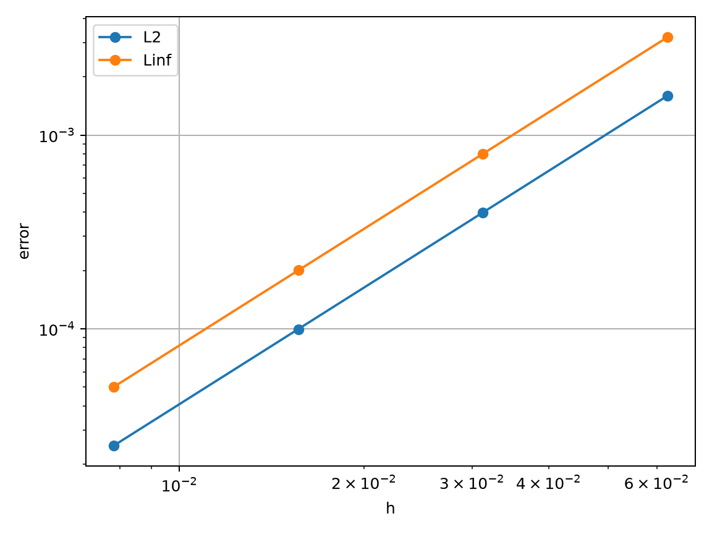
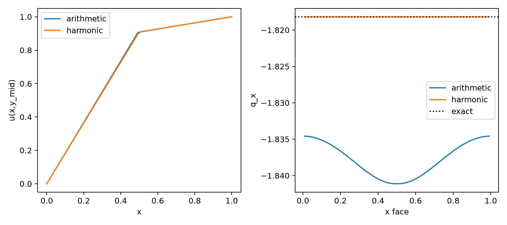
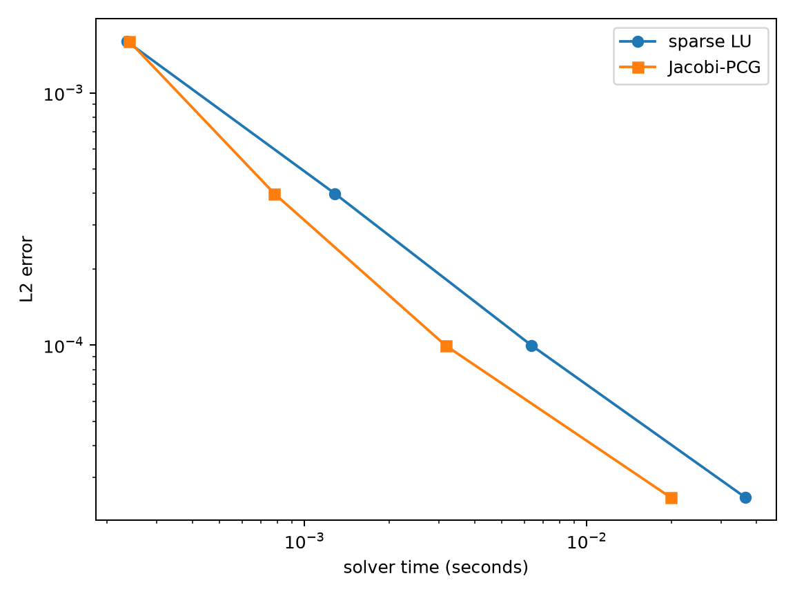
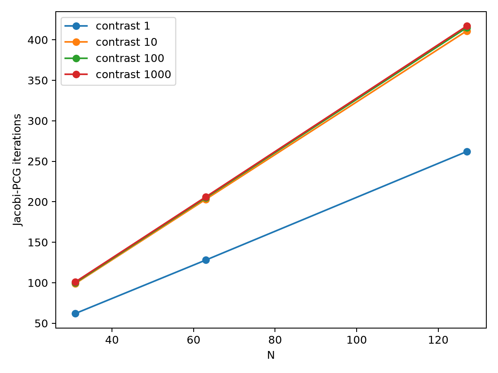
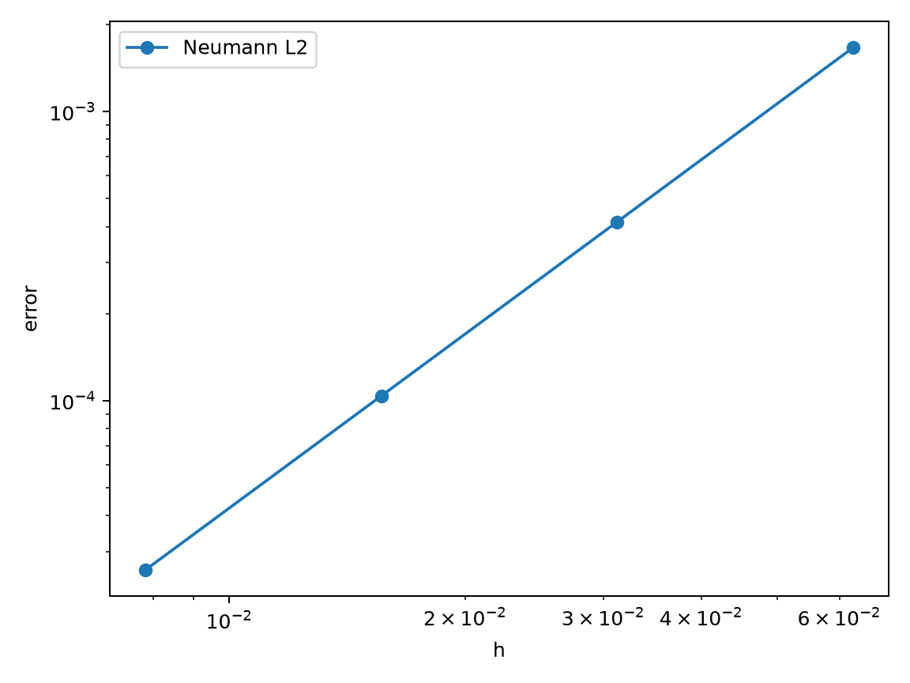

# Project 2 figures and underlying data

All figures below come from the runnable numerical core. The reference data
were measured on 7 October 2026; figures and CSVs are checked together by the
root reproduction command. The repository retains PNG for browser viewing
and PDF for export.

| Figure | What it checks | Raw data |
| --- | --- | --- |
| [Smooth convergence](smooth_convergence.png) | Four-mesh E2 and maximum-norm errors | [smooth.csv](../../code/project2/outputs/smooth.csv) |
| [Temperature and nodal error](smooth_field.png) | N=64 numerical field and exact-reference error | [smooth_field.npz](../../code/project2/outputs/smooth_field.npz) |
| [Matrix sparsity](matrix_spy.png) | Conservative five-point structure at N=64 | `assemble()` in [run_all.py](../../code/project2/run_all.py) |
| [Layered temperature and flux](interface_profiles.png) | Arithmetic/harmonic closures at N=63 | [interface.csv](../../code/project2/outputs/interface.csv), [profile_arithmetic.csv](../../code/project2/outputs/profile_arithmetic.csv), [profile_harmonic.csv](../../code/project2/outputs/profile_harmonic.csv), [flux_arithmetic.csv](../../code/project2/outputs/flux_arithmetic.csv), [flux_harmonic.csv](../../code/project2/outputs/flux_harmonic.csv) |
| [Cost versus accuracy](cost_accuracy.png) | LU/PCG median total solver time versus E2 | [solver_comparison.csv](../../code/project2/outputs/solver_comparison.csv), [timing_samples.csv](../../code/project2/outputs/timing_samples.csv) |
| [Contrast iterations](contrast_iterations.png) | Mesh/contrast dependence at rtol=1e-10 | [contrast.csv](../../code/project2/outputs/contrast.csv) |
| [Neumann convergence](neumann_convergence.png) | Cell-centred mean-zero cosine reference | [neumann.csv](../../code/project2/outputs/neumann.csv) |
| [Stationary spatial scan](spatial_scan.gif) | Different y-slices of the same steady field | [smooth_field.npz](../../code/project2/outputs/smooth_field.npz) |

The GIF scans space. It is not a simulation of time-dependent heat flow.
The N=63 layered profiles use `y=31/63`, the near-centre grid line.
All layered flux diagnostics are on this horizontal cut, not global flux norms.

## Browser previews

See [verification details](../../notes/project2/VERIFICATION.md) for the
norms, fitted orders, residuals and limits of these comparisons.
